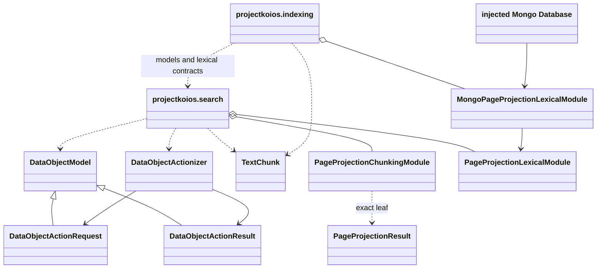

# `projectkoios` namespace implementation

The package is distributed as a namespace package from `src/python`. This
repository implements Search-owned modules while the `projectkoios` dependency
supplies shared thin base objects and existing chunking records.

Implementation modules import shared boundaries from their owning modules.
Only `projectkoios.search.page_projection_chunking` imports the Ingestion-owned
`PageProjectionResult`; Search indexing and retrieval modules remain independent
of Ingestion. Mongo connection construction and authentication remain outside
the repository's adapter and enter only as an injected database capability.
`projectkoios.search` and `projectkoios.indexing` use explicit initializers; the
namespace root itself has no initializer or implementation behavior.
