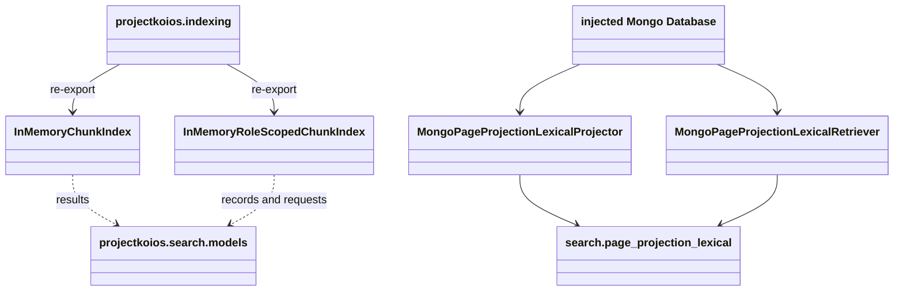

# `projectkoios.indexing` package implementation

The initializer explicitly re-exports `InMemoryChunkIndex` and
`InMemoryRoleScopedChunkIndex`. Those implementations retain records in process
memory and perform no persistence or network I/O. The direct
`mongodb_page_projection_lexical` leaf is deliberately not facade-exported; it
accepts an injected database capability and imports only Search-owned lexical
contracts plus PyMongo.

The role-scoped index requires an explicit admission policy. The simpler chunk
index has no role or purpose boundary and remains a distinct prototype. The
Mongo leaf stores immutable verified generation scopes and exposes exactly one
through an atomic pointer; it has no Ingestion, vector, model, API, workflow, or
application dependency.
