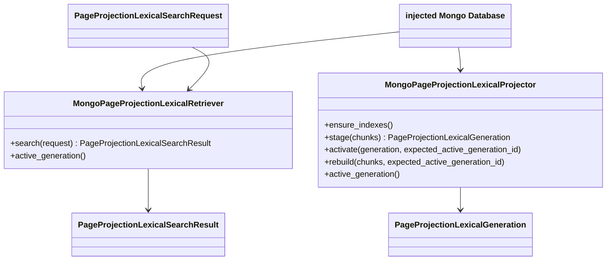

# `mongodb_page_projection_lexical` implementation

## Injected capability and fixed contracts

Both adapter classes require an injected `pymongo.database.Database` capability
and a nonempty opaque `storage_target_id`. Connection construction,
authentication, endpoint selection, secret storage, and environment routing are
outside this production module. Every collection access applies majority read
concern and majority write concern. Schema identity is
`projectkoios.search.mongodb-page-projection-lexical-index:1.0`; BM25 parameters
are fixed at `k1 = 1.2` and `b = 0.75`.

The adapter consumes the Search-owned `PageProjectionLexicalChunk` structural
protocol. It does not import Ingestion or the concrete
`page_projection_chunking` module. It owns no SQLite, FTS5, `mongot`, vector,
embedding, model, API, workflow, application, or publication path.

## Collections and immutable documents

| Collection | Generation-scoped content | Required identity/index |
|---|---|---|
| `page_projection_chunks` | Exact lineage, location, style, text, text measures, and token length | deterministic `_id`; unique `(generation_id, chunk_id)` |
| `lexical_term_postings` | term, chunk ID, positive term frequency, and document length | deterministic `_id`; unique `(generation_id, term, chunk_id)` |
| `lexical_statistics` | one corpus statistic plus one document-frequency statistic per term | deterministic `_id` |
| `lexical_generations` | immutable generation metadata and the singleton `active` pointer | generation ID or fixed pointer `_id` |

Chunk and posting indexes are created with fixed names and then verified for
exact key order and uniqueness. Generation-scoped `_id` values hash logical
kind, generation ID, and stable logical keys. Corpus average length is stored as
`float.hex()` so rebuilds do not depend on decimal formatting.



## Deterministic staging and verification

Staging consumes at most 1,000,001 iterable values and rejects a corpus above
the 1,000,000-chunk bound without exhausting further input. Each chunk is
validated structurally: identities, page-number/index relation, order, supported
style, exact strict-UTF-8 text digest and length, and tokenizer bounds. Duplicate
chunk IDs fail before persistence.

Chunks are sorted by chunk ID; postings by term then chunk ID; statistics by
kind then term. Per-chunk term counts retain repetition as posting term
frequency, while corpus document frequency increments once for each distinct
term present in a chunk. The full logical chunk/posting/statistic material is
hashed as canonical sorted compact JSON into `index_manifest_sha256`. Corpus,
index, and generation identities are derived before writes.

Metadata and data use bounded, ordered `$setOnInsert` upsert batches. Retrying
the same generation cannot overwrite existing content. Verification rereads all
generation documents and requires exact metadata, ready/staging state, counts,
deterministic storage IDs, and the complete canonical index-manifest digest.
Only then does metadata transition from `staging` to `ready`. An existing ready
generation is accepted only after the same complete re-verification, which gives
input-order-independent and clean-rebuild-equivalent behavior. Incomplete
inactive staging data remains invisible and can be retried; no delete privilege
is required.

## Atomic activation

Activation first requires exact ready metadata and repeats complete content
verification. First activation inserts the singleton `_id = "active"` pointer;
a concurrent insert loses through `_id` uniqueness. Later activation reads the
current revision and performs one `update_one` filtered by pointer ID, caller's
expected generation ID, and revision, while incrementing the revision. A stale
expectation or race matches no document and fails closed. Retrieval observes
only this pointer and immutable generation scope. No collection rename/drop or
multi-document transaction is used.

## Bounded deterministic retrieval

Retrieval validates the singleton pointer, ready metadata, storage target,
schema, tokenizer, corpus/index/BM25 identity, and revision. The versioned
tokenizer produces at most 256 unique query terms. The posting query asks for
`maximum_candidate_postings + 1`; observing the sentinel fails rather than
returning a truncated candidate set.

For each matching term and candidate chunk, standard Okapi BM25 is:

```text
idf = log(1 + (N - df + 0.5) / (df + 0.5))
score += idf * tf * (k1 + 1) /
         (tf + k1 * (1 - b + b * document_length / average_length))
```

Positive scores sort descending, with ascending chunk ID as the complete tie
break. The result limit is applied only after deterministic scoring and sorting.
Hits retain only chunk ID, exact float score, rank, and matched terms; the result
binds the active generation/corpus/index identities.

## Minimum development privileges

The routed capability needs only `find`, `insert`, `update`, `createCollection`,
`createIndex`, and `listIndexes` on the four exact collections. It needs no
delete, drop, rename, administrative, production, or transaction privilege.
The production adapter cannot create a connection and contains no physical
endpoint or authentication value.

## Development-only integration verifier

Repository module command
`.venv/bin/python -m scripts.verify_mongodb_page_projection_lexical` (from the
Search repository working directory with `shell=false`) is not a production
adapter. It hard-allows only database
`projectkoios_search_development`, storage target
`projectkoios.search.mongodb.development`, and the separately provisioned opaque
capability ID. It has no production mode. The operator supplies the complete
connection value through the exact inherited anonymous-pipe descriptor FD 3;
it never appears in argv, environment, output, or a file. The command reads
through EOF
with an 8,193-byte sentinel, rejects more than 8,192 bytes and any boundary
whitespace, CR/LF, or Unicode control character, and closes the descriptor
immediately.

The bounded operation reconstructs the frozen sanitized fixture, derives its
two production chunks, stages once and then replays the same corpus in reverse
input order, verifies exact measures and immutable content, makes an
already-correct active generation a verified no-op or otherwise performs the
pointer CAS, and verifies the fixed `canonical title` query with limit 2 and
candidate ceiling 8. The reverse pass is an idempotent permutation replay, not
an independent clean rebuild; the two-database unit test supplies clean-rebuild
equivalence evidence. The verifier never deletes or drops prior development
data. Client connect/server-selection timeouts are 5 seconds and socket timeout
is 15 seconds; the operator supplies a 120-second hard process timeout.

Success emits exactly one compact stdout JSON line of at most 16 KiB, empty
stderr, and exit `0`. Its exact keys and types are:

| Key | Type | Allowed value |
|---|---|---|
| `status` | string | exactly `verified` |
| `capability_id` | string | exact allowlisted opaque development capability ID |
| `database_name` | string | exactly `projectkoios_search_development` |
| `storage_target_id` | string | exactly `projectkoios.search.mongodb.development` |
| `generation_id` | string | verified derived generation ID |
| `active_generation_id` | string | exactly equal to `generation_id` |
| `corpus_id` | string | verified derived corpus ID |
| `index_id` | string | verified derived index ID |
| `chunk_count` | integer | exactly `2` |
| `posting_count` | integer | exactly `4` |
| `term_count` | integer | exactly `4` |
| `total_document_length` | integer | exactly `4` |
| `hit_chunk_ids` | array of strings | exact two deterministic fixture chunk IDs in rank order |
| `query_result_id` | string | verified derived result ID |

Handled failure also emits exactly one compact bounded stdout line, empty
stderr, no traceback or exception text, and no connection material. Its exact
keys are `status` (exactly `failed`), `exit_code` (integer `2`, `3`, or `4`), and
`category` (respectively `invocation`, `connection`, or `verification`). Exit 2
covers argv/allowlist/descriptor/secret-channel rejection, exit 3 a Mongo driver
capability failure, and exit 4 fixture, immutable staging, activation, or
retrieval verification failure.
