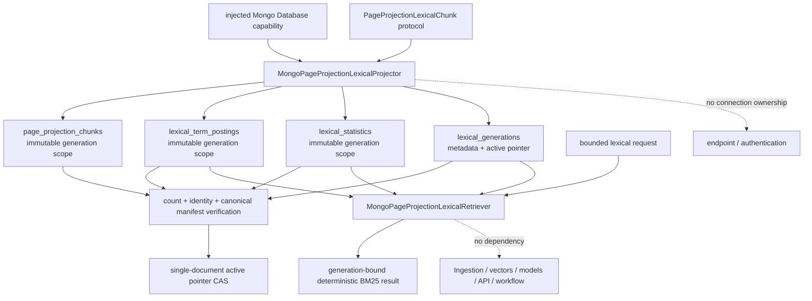

# `mongodb_page_projection_lexical` schematic

Generation documents remain invisible until complete verification and the
single active-pointer compare-and-set. No collection rename, drop, delete, or
multi-document transaction participates in the path.
