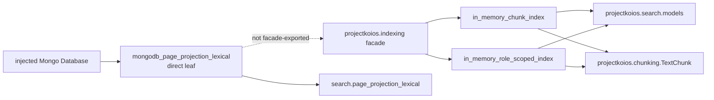

# `projectkoios.indexing` package schematic

The package provides implementations for Search-owned result and request
boundaries without moving those boundaries into the indexing package. The
Mongo leaf is imported directly so the facade remains independent of persistent
connection capabilities.
