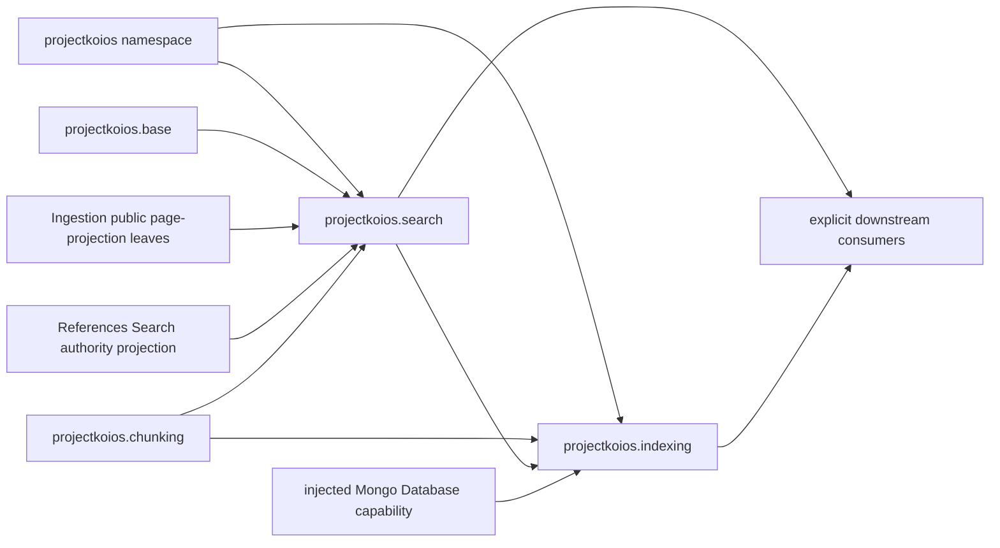

# `projectkoios` namespace schematic

`projectkoios.base` and legacy `projectkoios.chunking` are shared
dependency-owned boundaries. The Ingestion arrows terminate only at Search's
`page_projection_chunking` and `authority_bound_evidence` modules; References
terminates only at authority admission. Indexing and unrelated retrieval remain
independent of both. The Mongo lexical leaf consumes only Search-owned
structural contracts and an injected database capability. This repository's indexing implementations
consume Search-owned models while both package facades remain explicit. Neither
package acquires product authority from the namespace.
