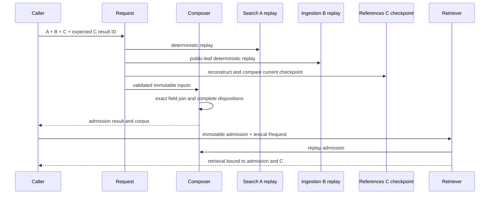

# Authority-bound evidence implementation

## Admission algorithm

1. Replay Search chunking and public Ingestion enrichment from their exact
   requests; reject stale or force-mutated result objects.
2. Reconstruct every References typed artifact link from primitive fields,
   reconstruct every binding from primitive fields and the replayed links, then
   reconstruct the outer projection. Compare each replayed value and require the
   final result ID to equal the caller-supplied expected-current checkpoint.
3. Require A and B to name the same page-projection result and enforce the fixed
   100,000-chunk input bound.
4. Index B by `source_evidence_id` and C by the exact tuple of `source_id`,
   `document_id`, and `artifact_verification_result_id`.
5. For each chunk in deterministic A order, require every page, block, source,
   projection, and artifact field in B to match A. Then require exactly one
   accepted C binding and typed artifact link.
6. Construct the existing `EvidenceItem` directly from the exact producer and
   authority values. Keep opaque Ingestion warnings on the admission provenance
   instead of translating them into Search warning semantics.
7. Emit an explicit omission for missing B, unavailable B, missing C, ambiguous
   or inconsistent bindings, and explicitly prechecked evidence-model bounds.
   Integrity or construction failures are never caught as `over_limit`.
8. Replay the full join in result construction and when a production retriever
   is constructed.

## Provenance and freshness

Each admission retains the exact chunk, enrichment, References binding, and
References typed link. Result identities commit to all admission and omission
identities, corpus identity, composer identity/version, request identity, and the
References result ID. Retrieval identities commit to the admission result and
underlying deterministic retrieval result.

References owns filesystem reobservation, typed linkage reload, and the
`SearchReferenceAuthorityProjectionRequest` → actionizer → result production
boundary in
`projectkoios.references.courses.authority.search_projection`. Search imports
typed linkage only from its defining `courses.authority.evidence` leaf, consumes
only the exact projection result type, and verifies that it equals the
References checkpoint the caller declares current; Search neither reads assets
nor fabricates freshness.

## Encapsulation enforcement

The production retriever is a stateless one-action `DataObjectActionizer`.
Admission and lexical intent live in a frozen, slotted
`AuthorityBoundEvidenceRetrievalRequest`; no constructor-held authority exists.
Search's repository-local strict-mypy plugin is the authoritative architecture
gate for this slice. It rejects private or nested classes, cross-module private
imports, public helper functions, mutable passive fields, operational DataObject
methods, stateful or multi-method Actionizers, multi-verb role classes, and
classes outside the DataObject/Request/Result/Actionizer/enum/error/action-
protocol taxonomy. Internal mechanics remain module-private pure functions.
