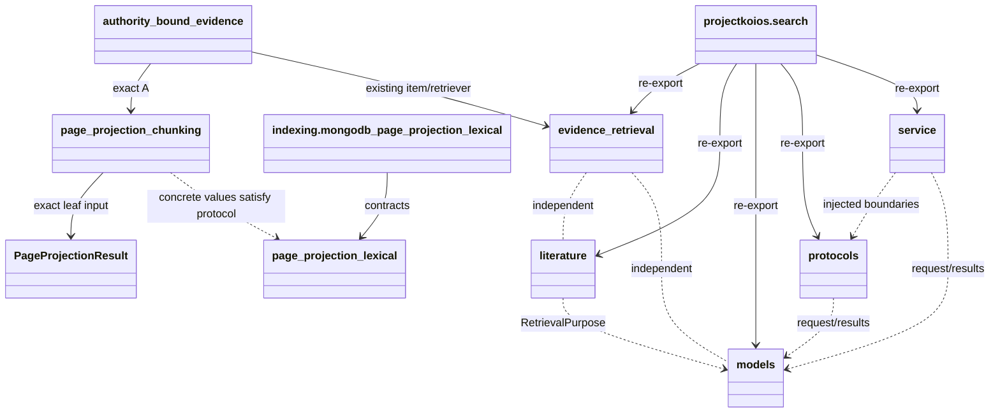

# `projectkoios.search` package implementation

The package initializer re-exports the established explicit inventory and keeps
all behavior in named modules. Authoring records import shared ABCs from
`projectkoios.base` and do not import the other search models. The
`page_projection_chunking`, `authority_bound_evidence`, and backend-neutral
`page_projection_lexical` remain direct public modules rather than facade
exports: this prevents ordinary imports from loading Ingestion, References, or
persistent adapters.

Facade exports preserve each defining module's class identity; the initializer
defines no classes of its own. Ingestion dependencies are limited to the exact
`PageProjectionResult` import inside `page_projection_chunking` and public
enrichment modules inside `authority_bound_evidence`; indexing and unrelated
retrieval modules import neither leaf. The package owns no API transport,
persistence, workflow, rights decision,
publication, or target-document behavior. `page_projection_lexical` owns only
backend-neutral immutable generation values; Mongo persistence is owned by the
separate indexing module. Public implementation classes are documented at exact
defining-module paths.
