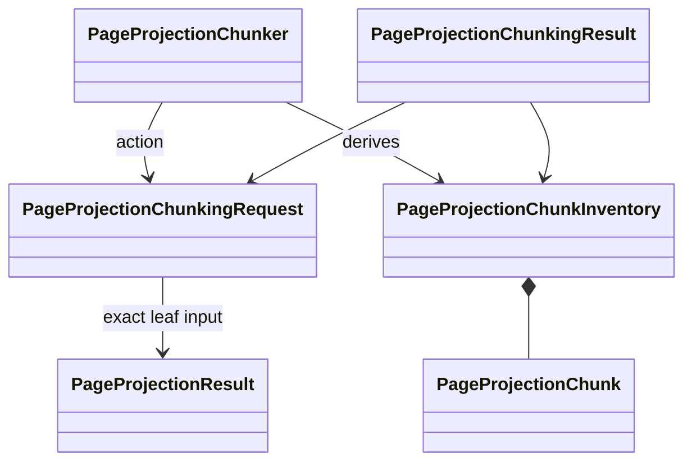

# `page_projection_chunking` implementation

## Exact dependency boundary

Only this module imports
`projectkoios.ingestion.page.projection.result.PageProjectionResult`. The
request requires that exact runtime type and reconstructs it through its public
constructor before identity derivation. The action and result repeat freshness
validation, so post-construction changes fail closed. No Search indexing module
imports Ingestion. The separate authority-admission module imports only the
public Ingestion enrichment leaf and does not dereference producer graphs.

## Fixed derivation policy

The request exposes no caller-selected size, overlap, tokenizer, corpus role, or
admission switch. Policy `page-projection-block-local` version `1.0` traverses
pages and projected blocks in their existing canonical order and emits one
chunk per nonempty projected block. Empty projected pages emit no chunk but
remain bound transitively through the page-projection result identity.

Each chunk carries exact text and SHA-256, style, page-local order, physical and
printed citation location, projected page/block identities, canonical source
page/block-or-caption identities, source/document identities, and upstream
source, artifact-verification, reading-projection, reading-inventory, and
page-projection result identities. It has no global chunk ordinal, so identity
is source-local rather than dependent on unrelated earlier chunks.

Chunk identity is canonical sorted compact JSON over the stable source, source
page, source block-or-caption, page location, projected-block identity,
page-local order, text digest/byte length, style, and explicit contract, policy,
and processor identity/version. The chunk and actionizer take processor identity
from one private non-circular implementation-identity owner. Chunk identity
deliberately excludes global result, inventory, provider, and
verification identities: rebinding otherwise identical source-local evidence to
a new complete result does not renumber that chunk. Those complete-generation
identities remain fields on the chunk for resolution.

Inventory identity incrementally hashes length-framed ordered chunk identities
plus the exact page-projection result identity and inventory contract version.
This avoids one unbounded JSON identity payload while preserving order and
makes the complete derivation change when any upstream result binding changes.
Request and result identities bind the fixed policy, implementation version,
and complete inventory identity.

## Bounds and failure behavior

Text and identity bounds match the consumed projection leaf: 262,144 UTF-8
bytes per block, 1,024 bytes per identity, and at most 1,000,000 chunks. Exact
built-in integers, immutable tuples, unique source order, unique chunk
identities, supported styles, matching projection-result bindings, and the
fixed chunker implementation identity are required. Unsupported, stale,
reordered, altered, or forged values raise `TypeError` or `ValueError` before a
result is returned.

## Cross-repository fixtures

The Ingestion-owned sanitized observation is copied byte-for-byte under
`tests/fixtures/page_projection/`. Tests verify its byte length, SHA-256, Git
blob OID, canonical typed reconstruction, and exact observed fields before
chunking. A Search-owned adjacent fixture freezes the expected request, chunk,
inventory, and result identities. These fixtures are conformance evidence only;
they define no production codec or wire format.
