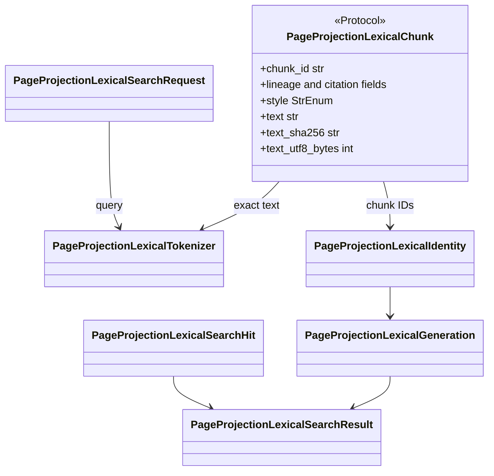

# `page_projection_lexical` implementation

## Narrow structural boundary

`PageProjectionLexicalChunk` is a runtime-checkable, read-only protocol listing
the exact lineage, location, style, text, digest, and byte-length fields the
lexical projector consumes. The existing concrete `PageProjectionChunk`
satisfies it structurally. The protocol has no constructor, serialization,
identity, mapping, or compatibility behavior and therefore is not a duplicate
DTO. This module imports neither `projectkoios.ingestion` nor the concrete
`page_projection_chunking` module.

## Tokenizer version `1.0`

The exact authoritative tokenizer identity is
`projectkoios.search.page-projection-lexical-tokenizer:1.0`. That routed version
binds Unicode casefolding and regular expression
`r"[^\W_]+(?:[.-][^\W_]+)*"`. Letters and digits form terms; an internal period
or hyphen joins adjacent term runs; underscores and all other punctuation are
separators. Casefolding occurs before matching. Tokens preserve source order and
repetition. Query terms remove repetition while preserving first occurrence.
The tokenizer ID is that exact opaque routed value; it is never replaced by a
derived pattern or configuration hash.

Input must be an exact nonblank built-in string, valid strict UTF-8, and no more
than 262,144 bytes. A lexical chunk may yield zero terms when its nonblank text
contains only separators.

## Corpus, index, and generation identity

The chunk manifest validates unique nonempty identities and sorts them
lexicographically. Its compact JSON SHA-256 and the corpus ID therefore do not
depend on caller order. The index ID binds the corpus ID, tokenizer ID,
persistent schema ID, and hexadecimal encodings of BM25 `k1` and `b`.

A generation binds corpus/index/schema/tokenizer/projector IDs, chunk-manifest
and full index-manifest SHA-256 values, and exact chunk, posting, term, and total
document-length measures. Its derived ID changes when any bound value changes.
All data objects are frozen, slotted, keyword-only values.

## Search values and bounds

A request accepts 1–2,000 nonblank valid-UTF-8 characters, at most 256 unique
versioned lexical terms, 1–100 requested hits, and a 1–100,000
candidate-posting ceiling. Its identity binds the exact query and both applied
numeric bounds. A hit requires one positive finite built-in-float score,
one-based rank, unique matched terms, and a stable chunk ID; its identity stores
the score as `float.hex()`.

A result binds the exact request, immutable generation, retriever identity,
versioned normalized query terms, and hits. It requires unique chunk IDs,
contiguous ranks, score-descending then chunk-ID-ascending ordering, matched
terms in query order, and no more hits than requested. The result exposes its
generation, corpus, and index identities directly and grants no publication,
workflow, model, or application authority.
