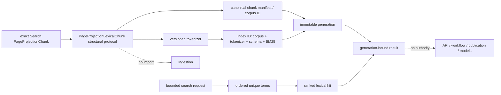

# `page_projection_lexical` schematic

Solid arrows show deterministic derivation or containment. Dotted arrows record
hard dependency and authority exclusions. Persistence adapters consume these
contracts but are not imported by this module.
