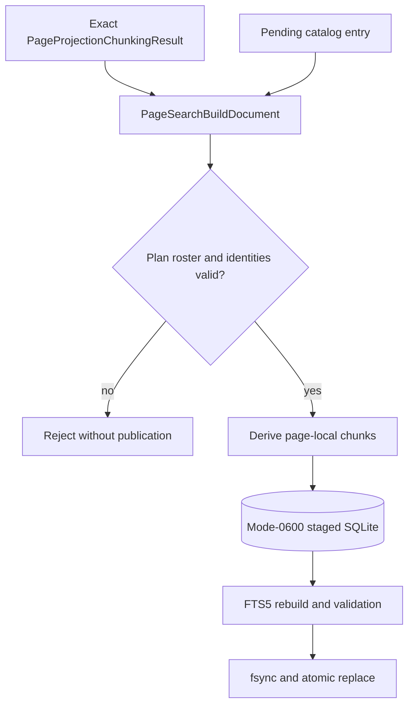
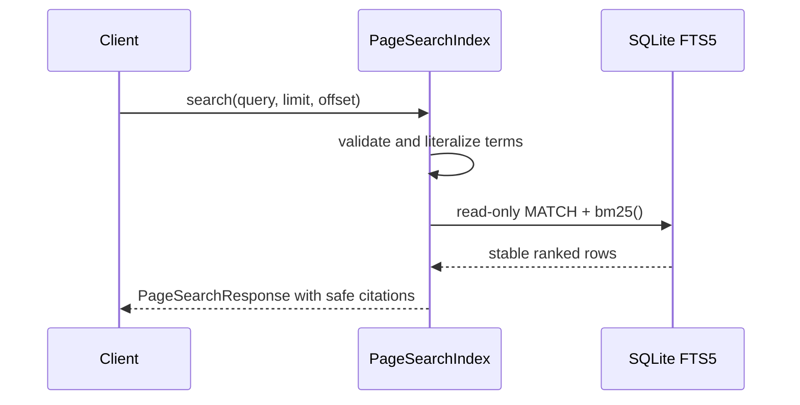

# Page-search implementation

## Typed build boundary

A build document contains catalog-safe identifiers and either an exact typed
Search `PageProjectionChunkingResult` or no projection. The plan requires a nonempty,
document-ID-sorted roster with unique document IDs, filenames, and projection
result identities. The roster is bounded to 100 documents, one million pages,
and one million projected blocks. The chunking result preserves exact owner
identities, complete contiguous page coverage, block provenance, and every empty
page from its typed Ingestion input.

Search derives page-local text from projected paragraphs, headings, and admitted
figure captions only. It sanitizes Unicode control and formatting characters,
collapses whitespace, and splits text above 5,000 characters without crossing a
physical-page boundary. Empty pages remain represented in coverage metadata.

## Storage and publication

Schema 2 stores slice metadata, safe document coverage, exact projection result
identities, physical pages, page-local chunks, and an external-content FTS5
table. The complete database is written to a mode-`0600` sibling, committed,
vacuumed, opened through the public reader, fsynced, and atomically replaced. A
failed plan or build removes staging artifacts and leaves the previous generation
unchanged. The reader also accepts deployed schema 1, whose documents have no
stored projection-result column.

## Read and rank

The owner reader opens SQLite with `mode=ro` and `query_only`, verifies database
and foreign-key integrity, slice/schema metadata, roster uniqueness, safe public
citation fields, per-document coverage, chunk/page bindings, and FTS row counts,
and rejects absent, foreign, corrupt, or unsupported files.
Queries become one to 16 literal Unicode terms joined with FTS5 `AND` and are
bounded to 256 characters. `limit` is 1–50 and `offset` is 0–1,000. Results order
by SQLite BM25, then document ID, physical page, and page-local chunk ordinal.
The DTO negates SQLite's raw score to report a positive `bm25_score` and bounds
plain snippets to 600 characters.

