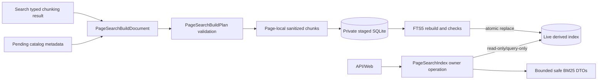

# Page-search schematic

The build path accepts typed owner results rather than transcript or publication
JSON. Projected text blocks enter page-local chunks in source order; equations,
media, paths, and publication payloads never enter storage or public results.
