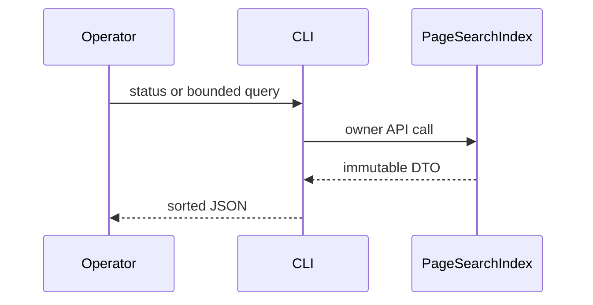

# Page-search CLI implementation

The CLI accepts an explicit database path and either the `status` or `query`
operation. Query limit and offset values pass unchanged to the owner API for
validation. Dataclass and tuple results are recursively converted to JSON-safe
objects; the adapter does not open SQLite or implement ranking.

