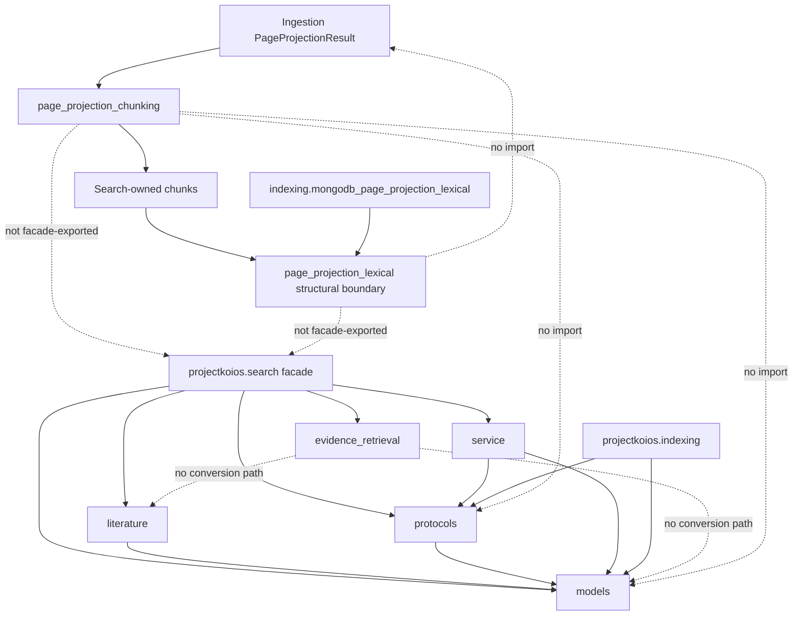

# `projectkoios.search` package schematic

Solid arrows represent imports, derivation, or facade exports. Dotted
relationships are explicit non-integration boundaries. Page-projection
chunking is the sole Ingestion-dependent module and remains independent of
indexing and retrieval; the authoring family neither wraps nor silently
converts the other prototype records.
