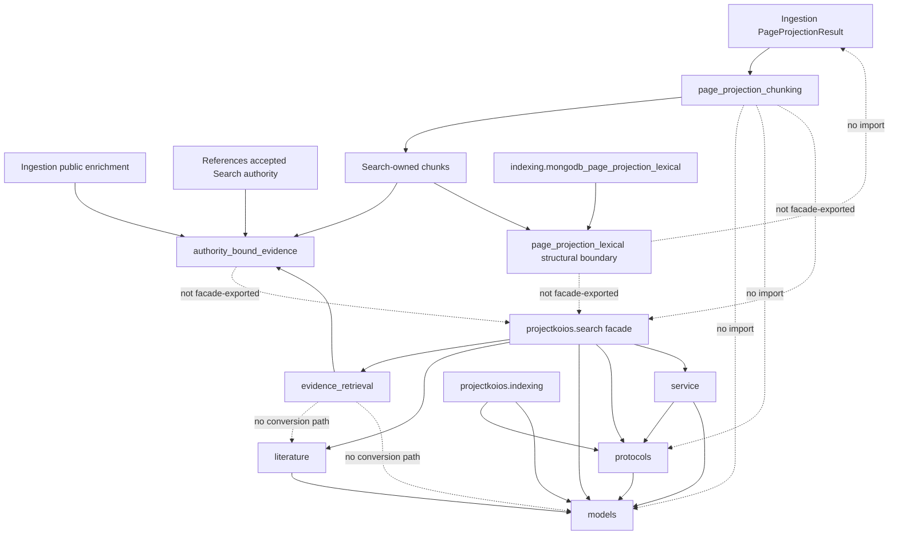

# `projectkoios.search` package schematic

Solid arrows represent imports, derivation, or facade exports. Dotted
relationships are explicit non-integration boundaries. Page-projection
chunking and authority admission are the only Ingestion-dependent modules and
use separate exact public leaves. The authority module composes rather than
mutates candidate-capable evidence records; unrelated indexing and retrieval
remain independent of producer packages.
